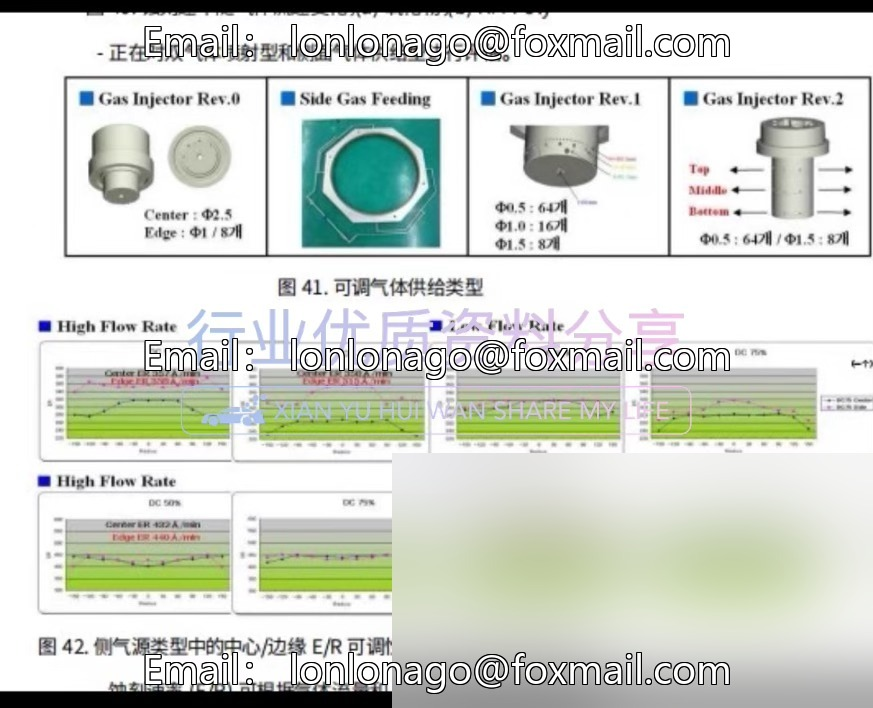
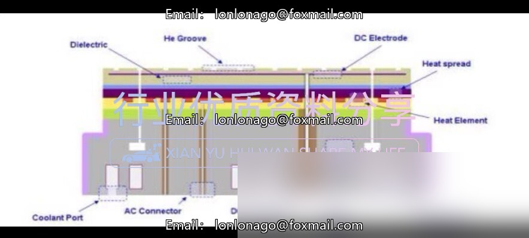
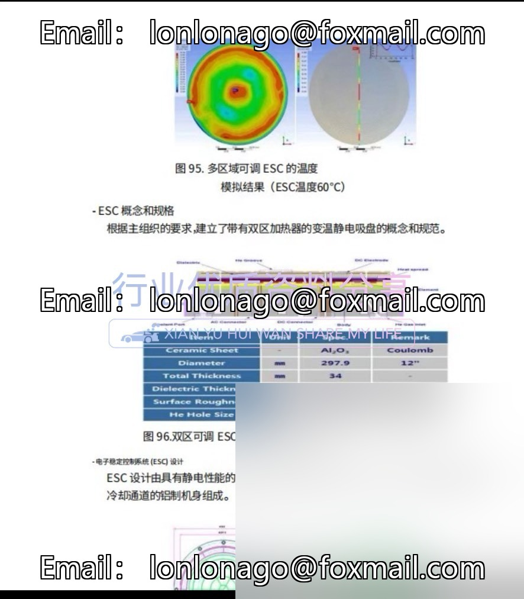
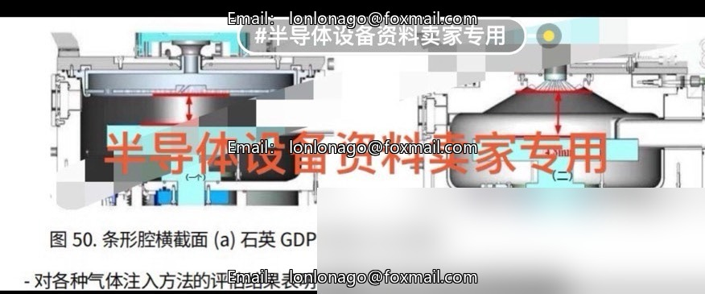
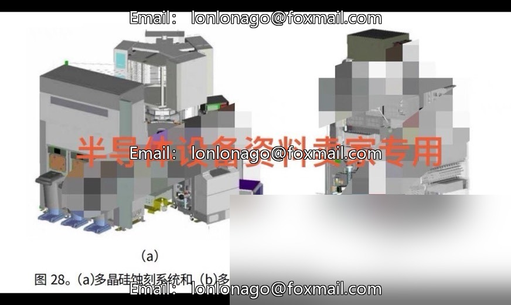
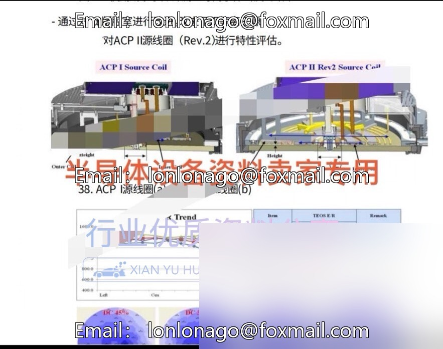
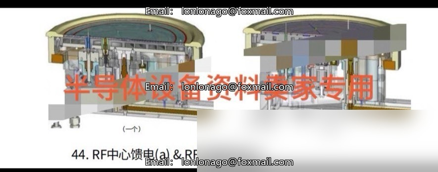
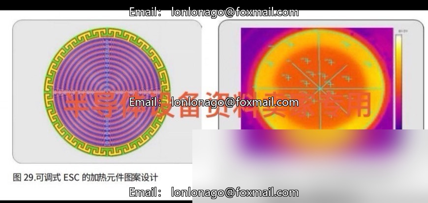

# [Dry Etching]Research materials on dry etching device technology and ESC CHUCK

## Body

[Dry Erosion] Research materials of dry erosion equipment technology and ESC CHUCK deep research: content details a large amount of core technology, design details verification and analysis, computing theory and relevant data analysis etc......! Around 200 pages! All content is practical, with no page being superfluous!
Core technology materials obtained through extensive relationship discussions; do not commercialize! Available for learning and reference only! Materials are organized and obtained! PDF materials!

Capture and send the electronic original directly! The following images include screenshots of the file portion. Please confirm before placing the order! Due to the replicable nature of electronic documentation Therefore, are allowed after purchase! Thanks for understanding!

For personal learning and reference use only.

The materials cover dry etching equipment technology, in-depth studies of ESC CHUCK, evaluation of dual gas injection and side gas feeding models, as well as parameters such as gas injectors, temperature control and electrostatic performance.

<!-- AI_ENRICHED -->

## Images

## Payment

Here is a pay link on Stripe ( https://buy.stripe.com/3cs8yP7sY87d0vu9AB ). Please contact me lonlonago@foxmail.com after funding $89, and I will send you a complete data files , thank you!

